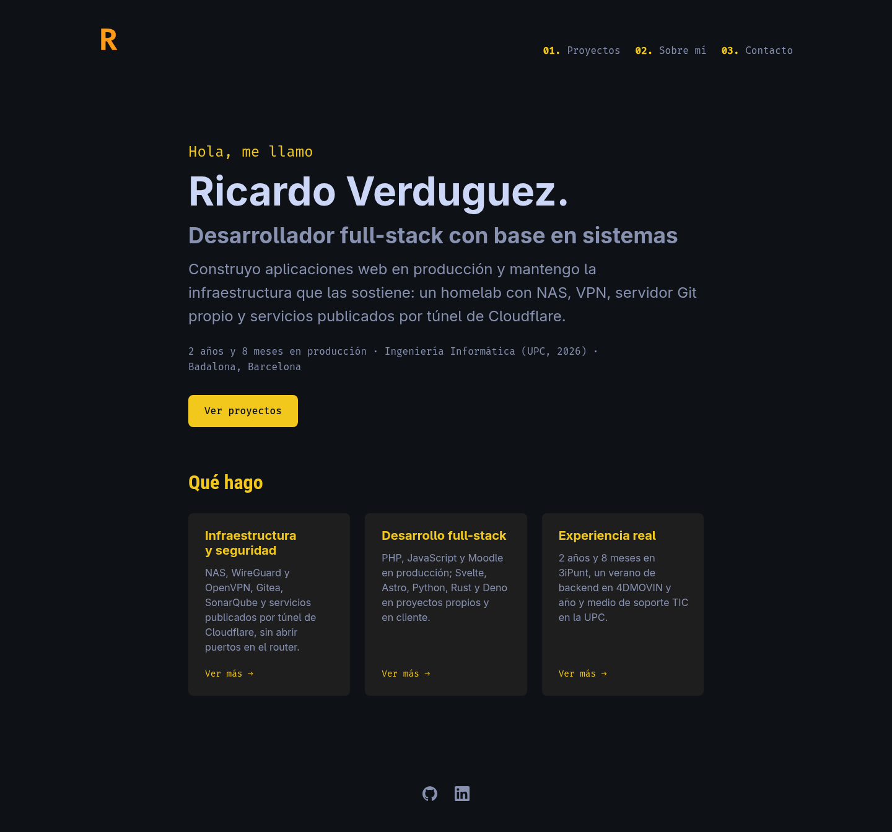
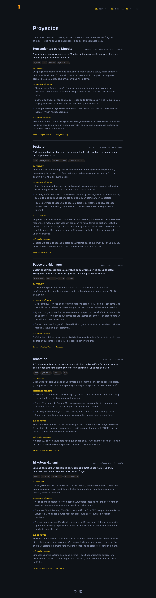
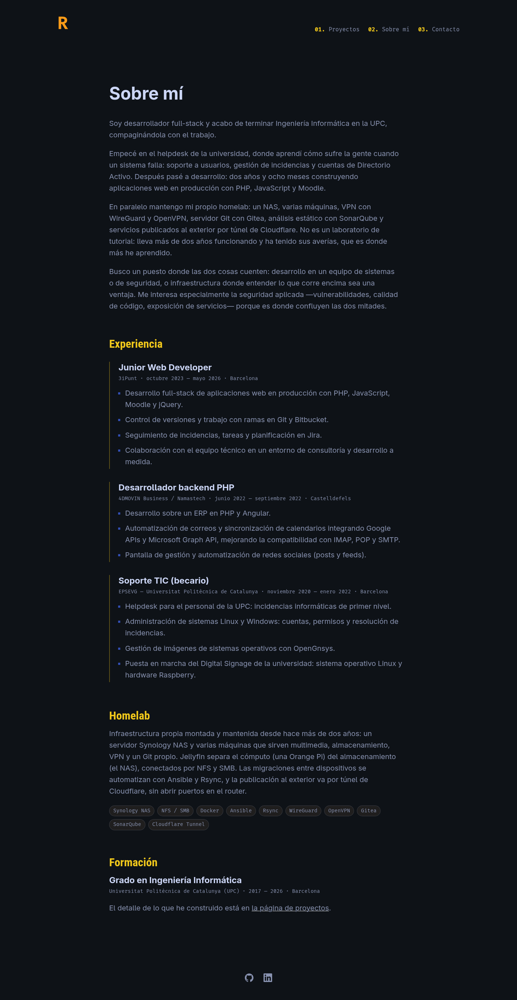
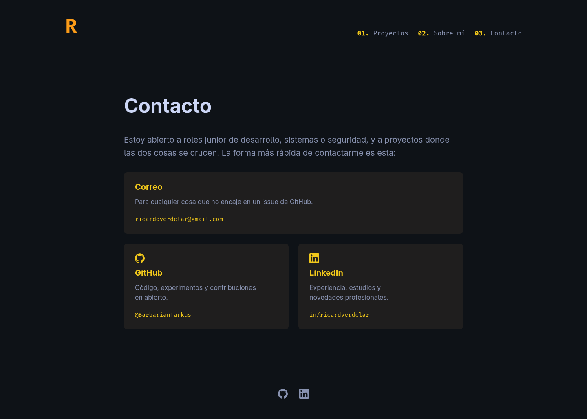
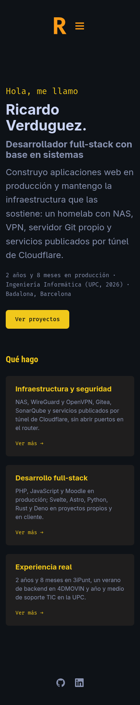
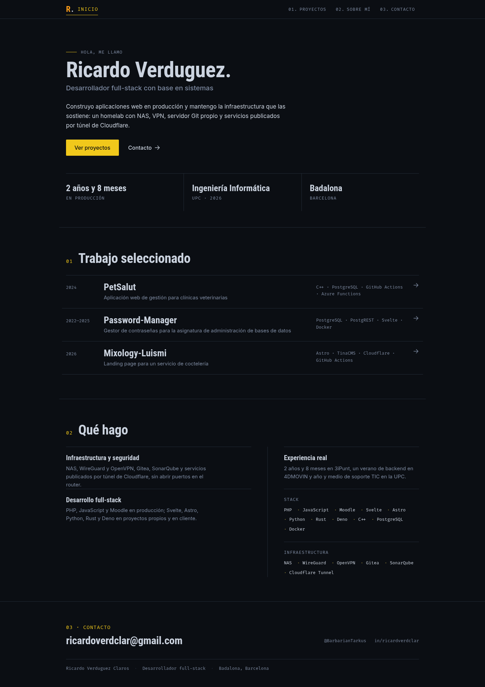
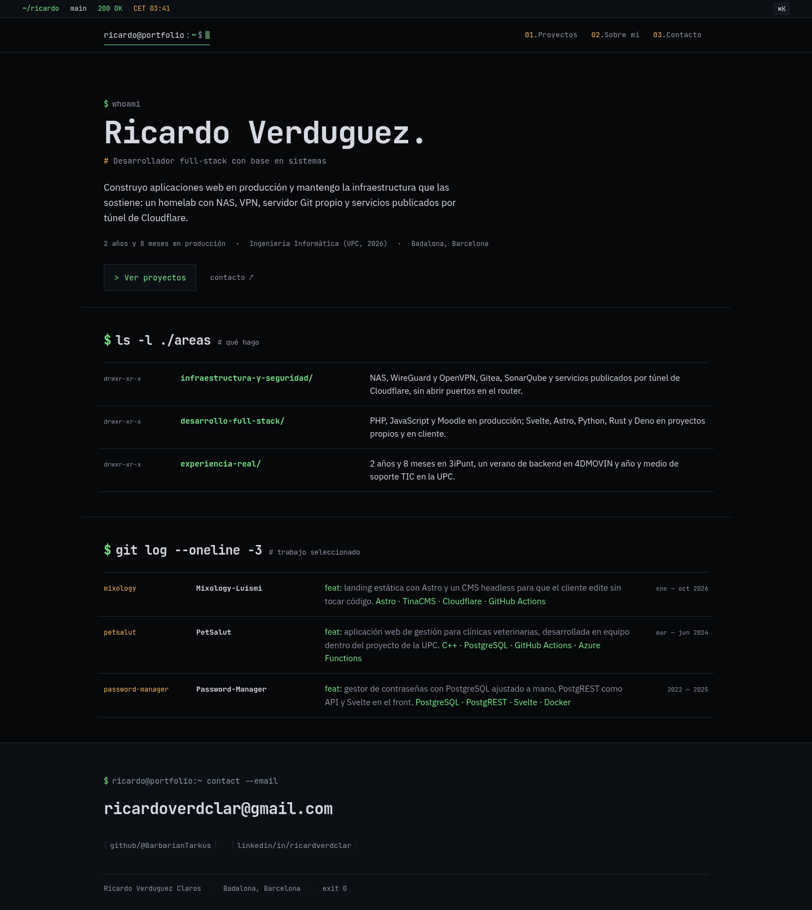
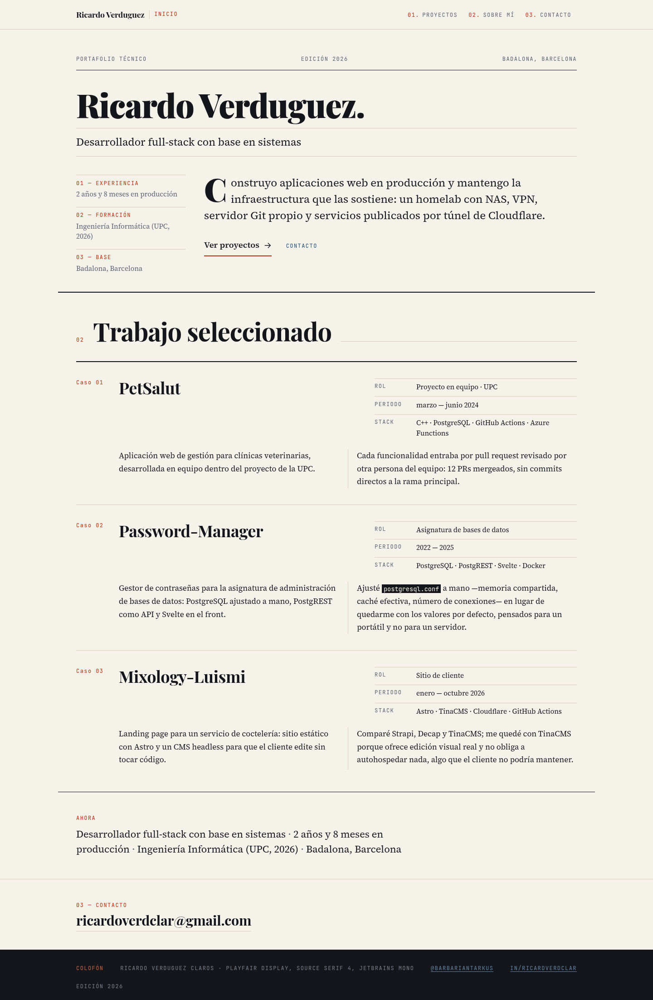
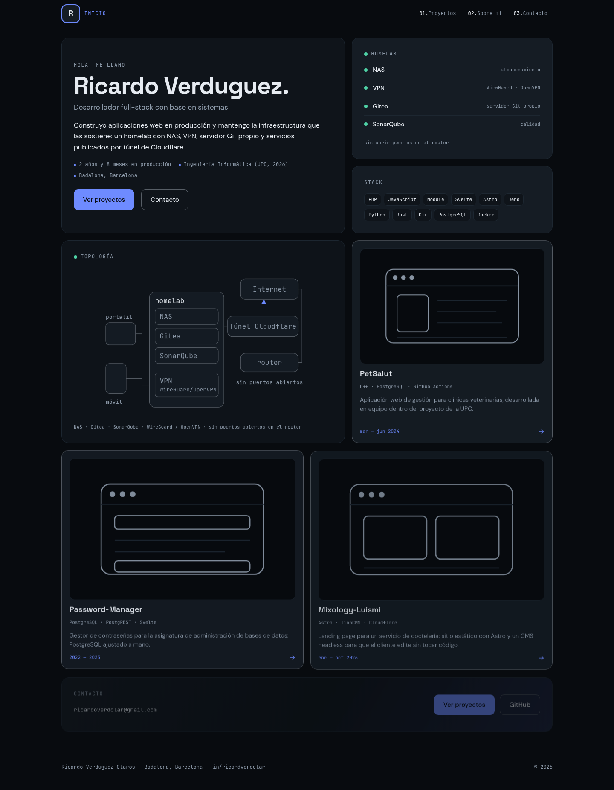

# Redesign paths

Status: **Path A implemented** (2026-10-28) — see
[`docs/signal-pass-2026-10-28.md`](signal-pass-2026-10-28.md). This document is
kept as the decision record: four directions, their costs, and why A was chosen.

Written 2026-10-28 · Scope: four distinct directions for the portfolio, with
effort, risk and a recommendation.

Supporting material:

- [`docs/redesign/briefs.md`](redesign/briefs.md) — the locked token/type brief
  each path is built from.
- [`docs/redesign/research.md`](redesign/research.md) — corpus validation,
  contrast ratios and UX rules per path.
- [`docs/redesign/feasibility.md`](redesign/feasibility.md) — codebase impact,
  measured accessibility baseline, path-independent wins.
- [`docs/redesign/preview/index.html`](redesign/preview/index.html) — four
  clickable mockups (open in a browser; no build step).

---

## TL;DR

Four paths, each optimising for a different job:

| Path             | One line                                                  | Effort    | Risk        |
| ---------------- | --------------------------------------------------------- | --------- | ----------- |
| **A · Signal**   | Keep the brand, spend the effort on craft and structure   | **3.5 d** | Low         |
| **B · Operator** | Run the site like a well-configured console               | **6 d**   | High        |
| **C · Dossier**  | Editorial, light, print-first — the contrarian play       | **6.5 d** | Medium-high |
| **D · Homelab**  | Bento dashboard: show the systems half, don't describe it | **7.5 d** | High        |

Effort is a costed estimate from [`feasibility.md`](redesign/feasibility.md),
not a guess: it counts the 1,257-line stylesheet, the Fresh/SSG constraints and
the QA time.

**Recommendation: A now, then C as the visual bet.** A is the only path under
four days that fixes four of six defects, adds no island, no binary asset and no
build-script change. C is the strongest differentiator but costs 6.5 days, and
doing it _after_ A costs about 4 more (A already pays for the grid, the index
and the case-study layout; C's remaining work is the palette inversion and the
typography) — roughly one extra day for a working site in the meantime. B is the
most _memorable_ option but it is also a saturated genre in developer portfolios
and the riskiest to build well; D is the only path that cannot ship without
artwork that does not exist yet.

The decision rests on one question: should the portfolio **filter** (survive a
six-second recruiter scan) or **differentiate** (make an engineering manager
remember him)? A and C optimise filtering; B optimises memorability by genre; C
optimises memorability by contrast with every other dev portfolio.

---

## 1. Where the site stands today

Measured, not estimated:

| Fact                | Value                                                                         |
| ------------------- | ----------------------------------------------------------------------------- |
| Routes              | `/`, `/projects`, `/about`, `/contact`, 404                                   |
| Component code      | 798 lines of TSX across 11 files                                              |
| Stylesheet          | 1,257 lines of plain CSS, 149 rules, one file, no build step                  |
| Colour coupling     | **71 of 149 rules carry colour** — this is what makes a light theme dear      |
| Images / diagrams   | **0** — every page is text, borders and colour                                |
| Print stylesheet    | **0** `@media print` rules                                                    |
| Accent usages       | 26 `var(--text-accent)` references across the stylesheet                      |
| Shell               | 54rem (864px) centred column; ~576px unused at 1440px                         |
| Page height @1440px | home 1,344 · about 2,781 · **projects 5,488** · contact 1,029                 |
| Hard contrast fail  | blue `ul ::marker` `#324eb2` on `#0e1217` = **2.57:1**                        |
| Touch targets       | desktop nav links **25.6px** tall, fiche links **23px** (rule: 44px)          |
| Keyboard/JS         | mobile nav is CSS-hidden until an island adds `.open` — **no nav without JS** |
| Header alignment    | logo sits at 160px, content at 304px at 1440px: a 144px edge mismatch         |
| Link previews       | no `og:*`, no `twitter:card`, no canonical, no sitemap                        |
| Stack               | Deno Fresh + Preact, static-site generated, no runtime CSS                    |

**Home** — a hero followed by three equal cards; every card is a door to a page
that repeats the same three headings.

**Projects** — five full fiches stacked into a 5,488px column of prose, all at
the same weight, no index, no anchors, no visuals.

**About** and **Contact** are readable and the typography is consistent; they
are not where the problems are.

---

## 2. Six defects worth a redesign

Ordered by what they cost him, not by what is easiest to fix.

1. **The identity is borrowed.** Navy + one yellow + condensed headings +
   numbered nav + Fira Code labels is a recognisable lineage (Brittany-Chiang
   template family). It is competently executed and says nothing about him.
2. **The projects page is a wall.** 5,488px, five equal-weight fiches. A
   recruiter cannot tell in ten seconds which project is the strongest, and the
   best material ("Qué se rompió") is buried as the third block of each entry.
3. **No evidence layer.** Zero images, zero diagrams, zero metrics rendered as
   data. The homelab — his actual differentiator — is one paragraph and ten
   tags.
4. **Accent inflation.** Yellow is used for `h2`, links, buttons, tags, section
   headings, nav numerals, the active state and the logo. When everything is
   highlighted, nothing is.
5. **Wasted canvas.** An 864px column on a 1440px viewport leaves 40% of the
   screen empty; the layout is the same object at every desktop width.
6. **No print story.** The content is CV-adjacent, but there is no print
   stylesheet, so "print to PDF" produces a dark, navigation-heavy page.

---

## 3. Constraints that shape every path

Five things in the build tooling make some paths dearer than they look. They are
not blockers — they are line items, and they are why the effort table is not a
vibe.

1. **Dynamic routes are not supported.** `scripts/lib/routes.ts` maps file paths
   literally, so `routes/projects/[slug].tsx` produces the route
   `/projects/[slug]`. D's per-project detail pages need ~40 lines in
   `scripts/lib/routes.ts` + `render.ts` _before_ the first page can exist.
2. **A second island is not free.** `config.ts` reads `Deno.env`, which does not
   exist in the browser, so a new island must receive `basePath` as a prop — and
   it must server-render its links, because the SSG verifier only inspects
   `href`/`src`/`import` values present in the emitted HTML. B's command palette
   is therefore a verifier blind spot unless it is written carefully.
3. **"Live" data would be a lie.** The site is statically exported: B's status
   clock and C's "edition date" would bake the build timestamp and be stale
   forever, and D's uptime tile has no source in `data/site.ts`. Only A avoids
   the problem by not pretending.
4. **Fragment links are unverified.** The verifier matches `href="/…"` only, so
   anchors such as `#petsalut` ship with no safety net in any path.
5. **C is not a reskin.** 71 of 149 CSS rules carry colour, and `color-scheme`
   plus `theme-color` must flip as well; that is a file-wide pass, and it is why
   C is estimated at 6.5 days rather than 3.

**What the four paths inherit for free.** The desktop header/nav island, the
skip link, the 404 page, the icon set and the SSG verifier are all reusable
as-is in every path except where noted above. No path requires a new framework,
a CSS toolchain or a runtime dependency.

---

## 4. The four paths

Each path is specified down to tokens in [`briefs.md`](redesign/briefs.md) and
rendered as a mockup in [`preview/`](redesign/preview/index.html). Open the
mockups side by side — the descriptions below are deliberately shorter than what
you can see.

### A · Signal — keep the identity, fix the craft

**Positioning:** the same brand, executed like a product instead of a template.
Nothing about the palette says "new site"; everything about the layout says
"someone decided".

**Concept.** The 2026 pass already unified the accent and fixed the obvious
accessibility gaps. What is left is not a colour problem, it is an editing
problem: the site needs a real grid, a scanning layer, and an accent that is
rare enough to mean something. Keep `#0e1217`/`#f1c81b` and the code-label
motif; widen the shell to 68rem, drop the card chrome in favour of 1px rules,
cut accent usage to active states and links only, and add the two layers the
site is missing — an evidence strip on the home page and a project index above
the fiches.

**Signature detail:** the numbered index list of selected work — year, name,
stack, one-line outcome, hairline rules between rows. It looks like a technical
document's table of contents, which is exactly what it is.

| Token       | Value     | Role                                    |
| ----------- | --------- | --------------------------------------- |
| `--bg`      | `#0B0E13` | page                                    |
| `--surface` | `#12171F` | raised block, no shadow                 |
| `--line`    | `#232C38` | every rule and border                   |
| `--text`    | `#CBD3DF` | body                                    |
| `--muted`   | `#7F8CA3` | meta and secondary prose                |
| `--accent`  | `#F1C81B` | links, active state, CTA, index numbers |
| `--brand`   | `#FB9B18` | logo "R" only, as today                 |
| `--radius`  | `2px`     | near-square; 8px reads "webapp"         |

Type: **Roboto Condensed 700** (kept, 64/56/40px) + **Inter 400/500** body at
17px + **Fira Code** meta at 13px. Three families, but the third is only ever
13px uppercase.

**What changes per route**

- **Home:** hero → evidence strip (3 metrics, rules not cards) → selected-work
  index (3 numbered rows) → "Qué hago" as two columns of prose + stack list →
  footer CTA.
- **Projects:** index table at the top, then fiches with a sticky `01–05` rail;
  "Qué se rompió" becomes a pull-quote with a 2px accent rule.
- **About:** two-column — 4ch margin column for section numbers, 8ch prose.
- **Contact:** three rows instead of three cards: label · handle · arrow.

**Fixes defects:** 2, 4, 5, 6 (partial). **Effort: 3.5 days** (0.25 tokens, 0.5
grid, 0.75 home, 1.0 projects index, 0.5 about/contact, 0.5 QA). **Risk: low** —
no new dependencies, no new island, no build-script change, reversible file by
file. **Main traps:** a 68rem shell needs `min(68rem, 100% − 2·gutter)` or it
scrolls on 1024px; the index rows must fold to two lines at 390px or the
scannability premise dies. **Brand cost:** none; this is the same portfolio,
better made.

**Choose A if** the next milestone is an interview in the next month.

### B · Operator — the site as a well-configured console

**Positioning:** the interface behaves like the environment he actually runs.
Monospace chrome, a status line, paths as breadcrumbs, `man`-page fiches,
keyboard-first.

**Concept.** His differentiator is dev _plus_ sysadmin, and the copy already
reads like engineering notes rather than marketing. B makes the interface tell
that story: a persistent status bar (`~/ricardo · main · 200 OK · CET`), a `$`
prompt above the name, the three areas listed like `ls -l` output, recent work
as a `git log --oneline` list, and each project rendered as a man page
(`NAME / SYNOPSIS / DETAILS / BUGS / TODO`) — which maps one-to-one onto the
existing fiche blocks. A `⌘K` command palette (the one island) handles "go to",
"copy email", "open GitHub".

The trap is making body copy monospace. Mono is chrome; prose stays in IBM Plex
Sans at 17px, or the site becomes unreadable exactly where it must be read.

**Signature detail:** the status bar. It is one 32px line, it costs almost
nothing, and it makes the whole page feel administered rather than designed.

| Token      | Value     | Role                               |
| ---------- | --------- | ---------------------------------- |
| `--bg`     | `#06080A` | page, near-black                   |
| `--panel`  | `#0C1014` | panels and status bar              |
| `--line`   | `#1E262E` | borders                            |
| `--text`   | `#D3DAE1` | body                               |
| `--muted`  | `#8A96A3` | meta                               |
| `--accent` | `#7CE38B` | phosphor green: prompt, active, ok |
| `--warn`   | `#F0B25E` | amber: dates, status               |
| `--danger` | `#F2555A` | "qué se rompió"                    |

Type: **JetBrains Mono 400/700** for chrome and headings (max 56px) + **IBM Plex
Sans 400/500** for prose.

**What changes per route**

- **Home:** status bar → prompt → name → role → intro → `ls -l` areas →
  `git log` recent work.
- **Projects:** man-page sections; anchors as `/projects#petsalut`.
- **About:** `cat about.md` framing; experience as a git-log timeline.
- **Contact:** `contact --email` block plus two key-value rows.
- **New island:** command palette (and it must not break the SSG verifier).

**Fixes defects:** 1, 2, 3 (partial). **Effort: 6 days** (1.5 of them the
command-palette island, 1.0 the man-page fiches, 0.75 keyboard/a11y). **Risk:
high** — three technical traps: the status clock is a build timestamp, the
palette's client-rendered links are invisible to the SSG verifier, and its
Escape/Tab handling must compose with the existing header island's global
listener. **Brand cost:** it narrows him to "the terminal guy", which is either
the point or a cage.

**Choose B if** the goal is to be remembered by engineers, and he is willing to
rewrite some copy to be terser.

### C · Dossier — editorial, light, print-first

**Positioning:** the writing is the product. A technical broadsheet: warm paper,
one vermilion accent, an asymmetric editorial grid with marginalia, case studies
instead of fiches.

**Concept.** Almost every developer portfolio is dark with a code font; the
differentiation available is not more neon, it is _paper_. C treats the site
like a printed dossier: Playfair Display headlines, Source Serif body at 19px,
JetBrains Mono only for labels, a 12-column grid with a 3-column margin for
numbers, metadata and links, and a real `@media print` stylesheet so "print to
PDF" produces a clean CV appendix. Projects become case studies: a title block
(role, period, stack) across the measure, numbered sections in the body, stack
and links in the margin.

This is also the path that best serves his actual writing: the fiches are good —
problem, decisions, what broke, what he would change — and they read better in a
reading-optimised typeface than in a UI sans.

**Signature detail:** the margin. Numbers, roles, stack and links live in a
narrow left/right column while the argument runs down the main measure — the
layout says "this person has edited a document".

| Token        | Value     | Role                             |
| ------------ | --------- | -------------------------------- |
| `--paper`    | `#F5F2EA` | page                             |
| `--paper-2`  | `#EDE8DC` | inset, table rows                |
| `--ink`      | `#14161B` | headings and body                |
| `--muted`    | `#5C6270` | meta                             |
| `--rule`     | `#D6CFBF` | hairlines                        |
| `--accent`   | `#B4340F` | vermilion: numbers, rules, links |
| `--accent-2` | `#1F4E79` | inline links inside prose        |

Type: **Playfair Display 700/900** display + **Source Serif 4 400/600** body
(19px) + **JetBrains Mono** labels. 66ch measure. No shadows, no radii, no
gradients — rules and type size only.

**What changes per route**

- **Home:** masthead (72px serif name, rule-separated role, date line) → 24px
  lede → three case-study blocks with title blocks → "currently" note → colophon
  footer.
- **Projects:** each project opens as a case study with numbered sections and
  marginalia.
- **About:** CV as a printed table (role · company · period) with prose margins.
- **Contact:** a letter, not cards.
- **New asset:** print stylesheet (and it should be treated as a deliverable,
  not a test).

**Fixes defects:** 1, 2, 3 (partial), 5, 6. **Effort: 6.5 days** (1.5 of them
the palette inversion — 71 colour-bearing rules — plus 1.0 grid, 1.25 case
studies, 0.75 print). **Risk: medium-high** — missed colour declarations on
paper, `color-scheme`/`theme-color` leaking dark UA chrome, and the 1024px band
where the asymmetric grid has no breakpoint. **Brand cost:** leaves the "dark
hacker" identity; needs the light theme to be genuinely well set or it looks
like a WordPress theme.

**Choose C if** he wants to stand out from other junior dev portfolios and is
willing to be the person with the paper site.

### D · Homelab — bento dashboard, show don't tell

**Positioning:** sell the systems half visually. A bento grid of artifacts: a
status tile, a homelab topology diagram, work tiles with screenshots, stack
chips.

**Concept.** The most _visual_ path, and the only one that solves defect 3
head-on: instead of describing the homelab in a paragraph, draw it — NAS, Orange
Pi, Jellyfin over NFS/SMB, WireGuard, Gitea, SonarQube, Cloudflare Tunnel — and
put a status tile next to the hero. Project cards get 16:10 media, a hover lift
and a detail page per project. Palette moves to a cooler dark with a periwinkle
accent so it does not read as the current site with rounder corners.

**Signature detail:** the topology diagram tile. It is the one thing on the site
that cannot be copied from a template, because it is his actual rack.

| Token      | Value     | Role                      |
| ---------- | --------- | ------------------------- |
| `--bg`     | `#080B0F` | page                      |
| `--tile`   | `#0F141A` | tiles                     |
| `--line`   | `#1D2731` | tile borders (always 1px) |
| `--text`   | `#E6EBF1` | body                      |
| `--muted`  | `#8C99A8` | meta                      |
| `--accent` | `#6E8BFF` | primary action, links     |
| `--ok`     | `#4FD1A5` | status                    |
| `--warn`   | `#FFB454` | attention                 |

Type: **Space Grotesk 600/700** display (52–60px) + **DM Sans 400/500** body +
**JetBrains Mono** chips. 16px radii, one gradient maximum per view, no glass.

**What changes per route**

- **Home:** 12-column bento — hero 7×2, status 5×1, stack 5×1, homelab diagram
  7×2, three work tiles, full-width CTA.
- **Projects:** card grid with media, then detail pages reusing the fiche
  blocks.
- **About:** timeline as a vertical rail with tiles; homelab as a diagram.
- **Contact:** one wide tile plus two small.
- **New assets:** topology diagram, 3 project screenshots, an avatar.

**Fixes defects:** 2, 3, 5. **Effort: 7.5 days** (1.5 SVG artwork, 1.0 asset
pipeline, 1.25 SSG detail routes, 1.25 bento grid). **Risk: high** — three
blockers: detail pages need dynamic-route support that the build script does not
have, the five projects link to GitHub repos so "real screenshots" must be
re-captured, and the grid collapses to twelve stacked tiles at 768px. **Brand
cost:** modernises the palette but the genre is the most crowded of the four.

**Choose D if** he can produce the artwork (or accept CSS-drawn stand-ins) and
wants the site to look like a product.

---

## 5. Side by side

Scores 1–5, higher is better except Effort/Risk/Content dependency where higher
means _more_ cost.

| Criterion                      | A · Signal | B · Operator | C · Dossier | D · Homelab |
| ------------------------------ | :--------: | :----------: | :---------: | :---------: |
| Differentiation from templates |     2      |      4       |      5      |      3      |
| Memorability with engineers    |     2      |      5       |      4      |      3      |
| Six-second recruiter scan      |     4      |      4       |      4      |      5      |
| Readability of the fiches      |     4      |      2       |      5      |      3      |
| Trust / professionalism        |     5      |      3       |      5      |      4      |
| Print / PDF quality            |     2      |      1       |      5      |      2      |
| Effort (lower is better)       |     2      |      4       |      4      |      5      |
| Risk (lower is better)         |     1      |      4       |      3      |      5      |
| Content/artwork dependency     |     1      |      2       |      2      |      4      |
| Reversibility                  |     5      |      4       |      4      |      2      |

Read the matrix by row, not by column — no path wins every row. A is the only
one that is cheap _and_ safe _and_ keeps all options open; C is the only one
that fixes the reading experience; B and D buy personality with effort.

**What the design corpus actually validates.** Against the local UI/UX design
database, C and D are exact matches — C's Playfair + Source Serif 4 + JetBrains
Mono pair is the documented "Minimalist Monochrome Editorial" pairing, and D's
Space Grotesk + DM Sans is the documented "Tech Startup" pairing. A has **no**
corpus pairing for Roboto Condensed + Inter (nearest is a sports-font pattern)
and B has **no** terminal/CLI style at all (nearest is Cyberpunk UI, whose neon
and scanlines the brief rejects). That is not an argument against A or B — A's
premise is brand continuity and B's is structure — but it does mean C and D are
the two paths where the design decisions can be defended from a reference rather
than from taste alone.

**What the mocks cost in pixels.** Full home-page height, 1440 / 390:

| Version      | 1440px | 390px |
| ------------ | -----: | ----: |
| Current site |  1,344 | 1,956 |
| A · Signal   |  2,038 | 2,682 |
| B · Operator |  1,613 | 2,147 |
| C · Dossier  |  2,204 | 3,225 |
| D · Homelab  |  1,851 | 3,073 |

None of the four overflows horizontally at either width — measured in a browser
with `documentElement.scrollWidth`, not eyeballed. B is the densest at both
sizes; D grows the most on a phone, which is the measurable form of the bento
risk: the grid becomes a 3,000px scroll and the "dashboard" read disappears. The
extra height over the current site is the evidence layer and the project index
doing their job, not padding.

---

## 6. Contrast check

Every locked pair was computed before any code is written (method and full
matrix in [`research.md`](redesign/research.md)). Ratios are against the page
background unless noted; **4.5:1** is the floor for normal text, **3:1** for
large text, UI borders and focus rings.

| Path | Body text | Muted meta | Accent | Worst pair found                  | Verdict                                        |
| ---- | --------: | ---------: | -----: | --------------------------------- | ---------------------------------------------- |
| A    |     12.81 |       5.69 |  11.98 | `accent-dim` **3.62** (surface-2) | 1 token fails → corrected                      |
| B    |     14.22 |       6.66 |  12.63 | `danger` **5.34**                 | pass everywhere                                |
| C    |     16.18 |       5.46 |   5.46 | accent on `--night` **2.96**      | light pairs pass; inverted blocks need tokens  |
| D    |     16.45 |       6.79 |   6.38 | `accent` **5.56** (tile-2)        | pass everywhere; tile _separation_ is the risk |

Two findings changed the design, and both are cheap to fix now:

1. **A's `--accent-dim` failed** (4.32 on page, 3.62 on hover surface) because
   the brief used it for small nav numerals. Corrected to `#98873B` (4.52 worst
   pair). A whisper: the brief's own rule "accent text never below 15px" was
   fine — the token was the problem, not the rule.
2. **C's inverted blocks failed hard** — the paper-context accents (2.96 and
   2.09 on `#14161B`) would have been unreadable inside code/night blocks. Fixed
   by adding three context tokens rather than changing the locked palette
   (`#C56346`, `#6283A1`, `#7A7F8A`), so the paper design is untouched.

Two structural contrast notes:

- **Borders are not controls.** Decorative hairlines at 1.2–1.4:1 are exempt
  from WCAG, and all four paths use them deliberately. But if a border is the
  _only_ affordance of a control it must reach 3:1: `#595F69` (A), `#575D63`
  (B), `#8A857B` (C), `#575E66` (D).
- **D's bento separation is the real risk.** Tile-on-background is 1.07:1 and
  tile border 1.22:1 — a grid grouped only by that border reads as one flat
  field. The shadow ban stays (it is what prevents the SaaS look), so D needs a
  visible surface step, not just a rule.

---

## 7. Wins that pay off whichever path is chosen

Eight fixes independent of the path, ~1 day total. Every one of them is a defect
in the current code, not a taste preference, and every path pays for them again
if they are not done first.

| # | Change                                                       | Where                          | Cost  |
| - | ------------------------------------------------------------ | ------------------------------ | ----- |
| 1 | Repoint `ul ::marker` from the legacy blue to `--muted`      | `main.css:216–218`             | 2 ln  |
| 2 | Delete ~55 lines of dead CSS (5 rules that target nothing)   | `main.css`                     | −55   |
| 3 | One shared shell container for header, main and footer       | `main.css:254–255,287–297,588` | 15 ln |
| 4 | Make the mobile nav work without JS (`<html class="js">`)    | `main.css:382–404` + island    | 18 ln |
| 5 | Give desktop nav and fiche links 44px hit areas              | `main.css:536–541,1229–1236`   | 8 ln  |
| 6 | Name the five project articles (`h2 id` + `aria-labelledby`) | `ProjectFiche.tsx:42–44`       | 3 ln  |
| 7 | Split `--slate` into text and muted roles                    | `main.css:23` + 16 refs        | 10 ln |
| 8 | Add `og:*`, `twitter:card`, canonical and a sitemap          | `_app.tsx`, `ssg.ts`           | 35 ln |

Items 3 and 7 are prerequisites for the grids in A/B/D — doing them once avoids
a second pass over the same rules. Item 4 is the only outright bug in the list:
the static export currently ships a mobile menu that cannot open without
JavaScript.

---

## 8. Recommendation

> **Outcome:** Path A was chosen and implemented on 2026-10-28, with one change
> to the brief requested by the owner: work experience is the site's priority
> and is clearly separated from public GitHub projects (new `/experience` route,
> project `kind` labels). The rest of this section is the reasoning that led
> there, kept for context.

### The decision, in one question

> Is this portfolio meant to **filter** (prove competence fast to a recruiter)
> or to **differentiate** (be remembered by an engineering manager)?

- Filter → **A**, then stop. 3.5 days including the quick wins, no new risk,
  defects 2, 4, 5, 6 fixed.
- Differentiate → **C**, and accept that it is a brand decision, not a layout
  decision.
- "Differentiate, but I am a terminal person" → **B**, if he is willing to
  rewrite the copy to be terse.
- "I can produce artwork this month" → **D**, otherwise do not start it.

### Default recommendation: A now, C next

A is not a lesser version of C — it is the first half of it. Both paths need the
same new information architecture:

1. a project index above the fiches,
2. an evidence strip on the home page,
3. a wider shell with a real grid,
4. an accent used only for navigation,
5. a print stylesheet (C makes it a feature; A needs it too).

A's structure work (grid, index, evidence strip, case-study layout) is about 2.5
of C's 6.5 days; C's remaining cost is the file-wide palette inversion and the
serif typography. Doing C straight would be ~1 day cheaper than A-then-C, but it
is a big-bang rewrite with no working site in between. The sequence:

| Step | Work                                                                                                                   | Time     |
| ---- | ---------------------------------------------------------------------------------------------------------------------- | -------- |
| 1    | Path-independent quick wins (§7) — 8 fixes, ~1 day                                                                     | 1.0 day  |
| 2    | Path A structure: shell/grid, evidence strip, project index, case studies                                              | 1.5 days |
| 3    | Path A skin: tokens, Inter body, rules instead of cards, print stylesheet                                              | 1.0 day  |
| 4    | Live with it for a week; run the 3-second test in §9                                                                   | —        |
| 5    | If it still reads as "a template": the C skin on the same structure — paper palette, Playfair/Source Serif, marginalia | ~4 days  |

Total to a defensible redesign: **3.5 days**. Total to a distinctive one: **7.5
days**, with a working site in between and no big-bang rewrite. The extra day
over doing C alone buys a shipped improvement in week one.

### What would change this recommendation

- An application deadline in under a week → **A only**, stop after step 3.
- He is targeting design-adjacent or product roles → **C**, skip A.
- He has screenshots and a rack diagram ready → **D** becomes viable; it is the
  only path that makes the homelab visible.
- He wants to keep the dark theme _and_ be distinctive → **B**, but treat the
  status bar and the `man`-page section labels as the parts that matter, not the
  green.

### Risks that sink each path

| Path | What kills it                                                                 |
| ---- | ----------------------------------------------------------------------------- |
| A    | Doing only the token swap and calling it a redesign — the layout is the point |
| B    | Monospace prose, or the console being a costume with no keyboard behaviour    |
| C    | A light theme that is not tuned (grey soup), or fonts that load slowly        |
| D    | No real screenshots and no diagram — an empty bento is worse than text        |

---

## 9. How to decide in three minutes

**The three-second test.** Show each mockup to three people for three seconds,
then ask two questions: _"What does this person do?"_ and _"Which of their
projects is the strongest?"_ A path that fails the second question has not fixed
defect 2, whatever it looks like.

**The three questions only he can answer**

1. Filter or differentiate? (If he does not care about standing out, A is the
   answer and this document is 80% too long.)
2. Will he produce artwork — screenshots, a rack diagram, an avatar — in the
   next month? (No → D is out.)
3. Is the dark theme non-negotiable? (Yes → C is out. No → C is the strongest
   differentiator.)

**Scoring rubric**, if he wants to be mechanical: weight the six criteria
_first-time visitor clarity_ 25%, _differentiation_ 25%, _fidelity to his
identity_ 20%, _effort_ 15%, _risk_ 15%. A and C come out within a point; B and
D trade places depending on whether artwork exists.

---

## 10. What this proposal deliberately does not do

- **No implementation at proposal time.** This document described the four paths
  before any source file was touched; the mockups are standalone HTML under
  `docs/redesign/preview/`. Path A was implemented afterwards — see
  [`signal-pass-2026-10-28.md`](signal-pass-2026-10-28.md).
- **No light/dark toggle.** Only C changes mode, and adding a toggle to a
  dark-first brand produces two mediocre themes instead of one good one.
- **No new framework or CSS toolchain.** All four paths fit the existing plain
  CSS + Deno Fresh setup; D needs no build step either.
- **No traffic-light dashboards, no glitch/cyberpunk skin.** The corpus does
  return a "Cyberpunk UI" style for terminal-flavoured queries; it is rejected
  here because it is a costume (neon, scanlines, glitch) that would read as
  unserious to a hiring manager.
- **No content invention.** Every claim in the mockups comes from `data/site.ts`
  and the existing routes.
